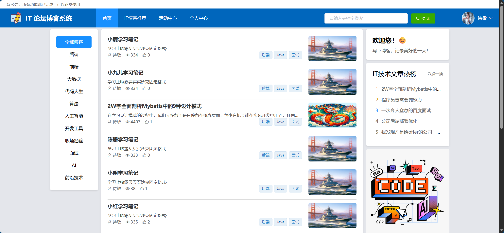
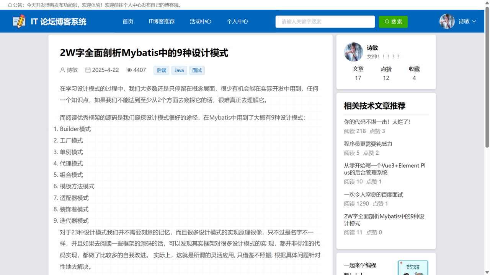
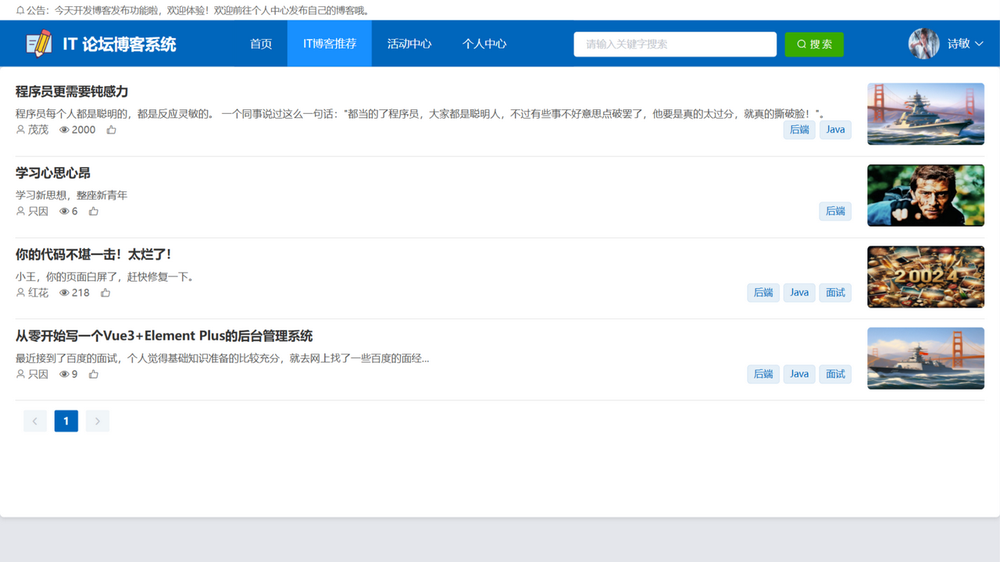
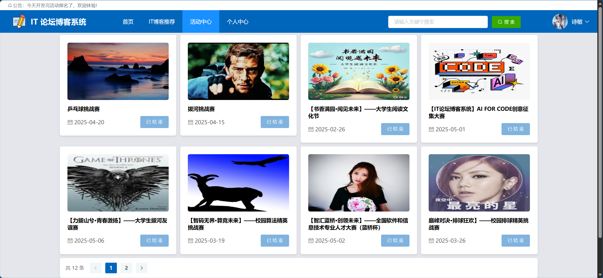
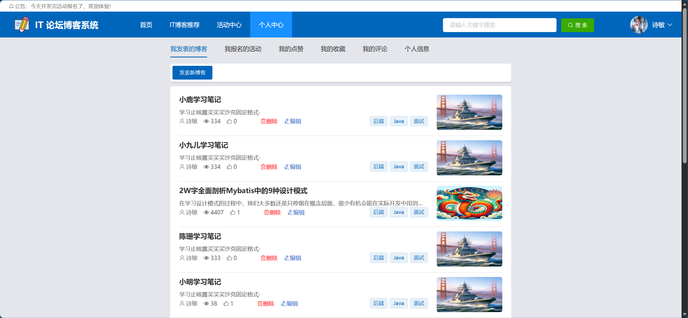
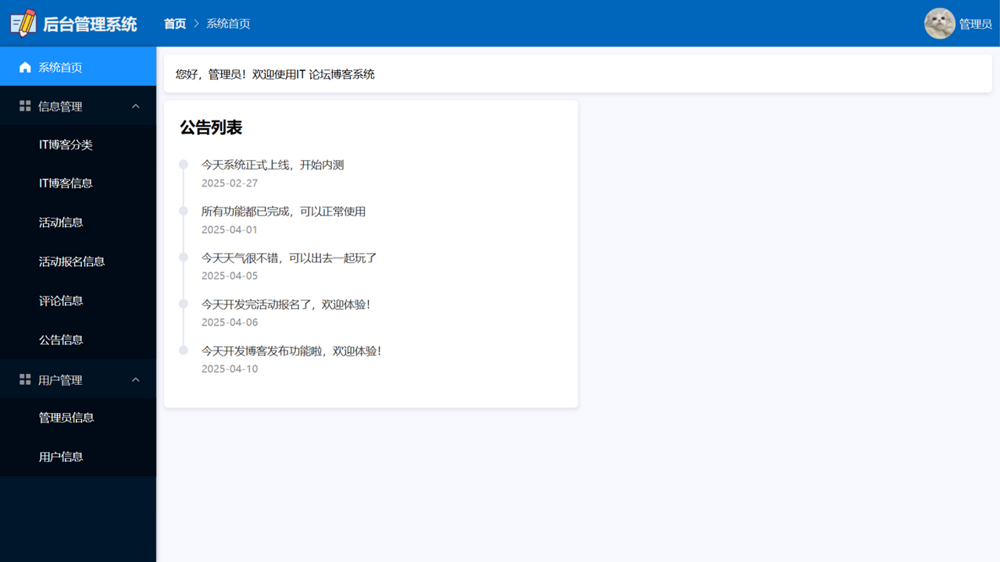

# IT Chat Blog — IT 技术交流博客论坛系统


一个基于 **Spring Boot + Vue** 前后端分离的 IT 技术交流博客论坛系统，支持博客发表与浏览、评论、点赞、收藏、活动报名、公告管理，并实现了**基于用户行为的协同过滤推荐**功能。

## 🖼 系统预览

### 前台（用户端）

| 首页 | 博客详情 |
|:---:|:---:|
|  |  |
| **IT博客推荐（基于用户行为的协同过滤）** | **活动中心** |
|  |  |
| **个人中心** | **登录** |
|  |  |

### 后台（管理端）

| 后台管理系统 |
|:---:|
|  |

## ✨ 功能特性

### 前台（用户端）

- 📝 **博客浏览与详情**：首页博客列表、分类浏览、富文本博客详情（代码高亮）
- 🔍 **博客搜索**：按标题关键词搜索博客
- ✍️ **发表博客**：wangEditor 富文本编辑器，支持代码高亮
- 💬 **互动功能**：评论、点赞、收藏
- 🎯 **活动中心**：查看活动详情、在线报名活动
- 🤖 **个性化推荐**：基于用户行为数据（浏览、点赞、收藏）的**基于用户的协同过滤（User-CF）**推荐博客
- 👤 **个人中心**：个人信息维护、修改密码

### 后台（管理端）

- 👥 用户管理、管理员信息管理
- 📢 公告信息管理
- 🗂 博客分类管理、博客信息管理
- 💬 评论信息管理
- 🎪 活动信息管理、活动报名信息管理

### 系统特性

- 🔐 JWT Token 登录认证，拦截器统一鉴权，区分管理员 / 普通用户角色
- 🌐 CORS 跨域配置，前后端分离部署
- 📤 文件上传支持（上传文件按 `时间戳-文件名` 形式存储于 `files/` 目录）
- 🧩 全局异常处理、统一响应结果封装（`Result`）、PageHelper 物理分页

## 🛠 技术栈

| 端 | 技术 | 说明 |
|---|---|---|
| 后端 | Spring Boot 2.5.9 | 基础框架（Java 8） |
| 后端 | MyBatis + PageHelper | ORM 与分页 |
| 后端 | MySQL | 数据库（库名 `xm-blog`） |
| 后端 | JWT（java-jwt 4.3.0） | 登录认证 |
| 后端 | Hutool 5.8 | Java 工具库 |
| 前端 | Vue 2.6 + Vue Router 3 | 前端框架与路由 |
| 前端 | Element UI 2.15 | UI 组件库 |
| 前端 | axios | HTTP 请求 |
| 前端 | wangEditor 4 | 富文本编辑器 |
| 前端 | highlight.js | 代码高亮 |

## 📁 项目结构

```
my_ITCHatblog
├── xm-blog.sql                   # 数据库建表脚本（仅表结构）
├── springboot/                  # 后端 Spring Boot 工程
│   └── src/main/
│       ├── java/com/example/
│       │   ├── common/          # 通用模块：CORS 配置、JWT 拦截器、Result 封装、枚举
│       │   ├── controller/      # 控制器层（博客、评论、点赞、收藏、活动、公告等）
│       │   ├── entity/          # 实体类
│       │   ├── exception/       # 全局异常处理
│       │   ├── mapper/          # MyBatis Mapper 接口
│       │   ├── service/         # 业务逻辑层（含协同过滤推荐服务）
│       │   └── utils/           # TokenUtils 等
│       └── resources/
│           ├── application.yml  # 端口、数据库、MyBatis、分页配置
│           └── mapper/          # MyBatis XML 映射文件
├── vue/                         # 前端 Vue 工程
│   └── src/
│       ├── views/front/         # 前台页面（首页、博客详情、搜索、活动、推荐等）
│       ├── views/manager/       # 后台管理页面
│       ├── components/          # 公共组件
│       ├── router/              # 路由配置
│       └── utils/               # axios 请求封装
└── files/                       # 用户上传文件的存储目录
```

## 🚀 快速开始

### 环境要求

- JDK 1.8+
- Maven 3.6+
- MySQL 5.7 / 8.0
- Node.js 14+

### 方式一：Windows 一键启动（推荐）

项目根目录提供了一套双击即用的批处理脚本（前端已构建并嵌入后端，单端口 **9090** 同时提供页面和接口）：

| 脚本 | 作用 |
|---|---|
| `start-backend.bat` | 启动后端服务（自动检测端口占用、启动后最小化窗口并打开浏览器） |
| `stop-backend.bat` | 停止后端服务 |
| `打开系统.bat` | 在浏览器中打开系统首页 |
| `build-all.bat` | 前端 `npm install + build` → 产物复制进后端 `static/` → Maven 打包 jar |
| `open-in-idea.bat` | 用 IntelliJ IDEA 打开本工程 |

日常使用：**双击 `start-backend.bat`**，浏览器自动打开 http://localhost:9090 即可。修改代码后需重新构建时，双击 `build-all.bat`。

> 说明：
> - `start-backend.bat` 默认调用 PATH 中的 `java`；若 java 不在 PATH，可新建 `start-backend.local.bat`（已被 gitignore）写入 `set "JAVA=你的java.exe完整路径"`。
> - 数据库密码等本机配置放在 `springboot/application-local.yml`（已被 gitignore，不会提交），启动脚本会自动加载；也可以直接改 `application.yml`。

### 方式二：前后端分离开发模式

#### 1. 克隆项目

```bash
git clone https://github.com/Captainlidong/my_ITCHatblog.git
cd my_ITCHatblog
```

#### 2. 配置数据库

1. 在本地 MySQL 中创建数据库 `xm-blog`（字符集 `utf-8`）
2. 修改 `springboot/src/main/resources/application.yml` 中的数据库连接信息：

```yaml
spring:
  datasource:
    username: root            # 你本地的数据库用户名
    password: your_password   # 你本地的数据库密码
    url: jdbc:mysql://localhost:3306/xm-blog?useUnicode=true&characterEncoding=utf-8&allowMultiQueries=true&useSSL=false&serverTimezone=GMT%2b8&allowPublicKeyRetrieval=true
```

3. 导入建表脚本 [`xm-blog.sql`](./xm-blog.sql)（包含全部表结构，可在 Navicat 等数据库工具中直接运行）：

```bash
mysql -uroot -p xm-blog < xm-blog.sql
```

> ℹ️ 脚本仅包含表结构，不含初始数据。普通用户可从前端注册页 `/register` 自行注册；如需登录后台管理端，请先向 `admin` 表插入一条管理员记录（密码以明文存储比对），例如：
>
> ```sql
> INSERT INTO `admin` (`username`, `password`, `name`, `role`) VALUES ('admin', 'admin', '管理员', 'ADMIN');
> ```

#### 3. 启动后端

```bash
cd springboot
mvn spring-boot:run
```

或在 IDEA 中直接运行 `SpringbootApplication` 主类，默认端口 **9090**。

#### 4. 启动前端

```bash
cd vue
npm install
npm run serve
```

启动后访问 **http://localhost:8080**。

> 前端默认将 API 请求发送到 `http://localhost:9090`，可通过修改 `vue/.env.development` 中的 `VUE_APP_BASEURL` 指向实际后端地址。

## 🔧 主要配置说明

| 配置文件 | 说明 |
|---|---|
| `springboot/src/main/resources/application.yml` | 后端端口（9090）、数据库连接、MyBatis 映射、PageHelper 分页、上传文件大小限制 |
| `vue/.env.development` | 开发环境后端 API 地址（`VUE_APP_BASEURL`） |
| `vue/.env.production` | 生产环境后端 API 地址 |
| `vue/vue.config.js` | 前端开发服务器端口（8080） |

## ⭐ Star History

如果这个项目对你有帮助，欢迎点一个 Star ⭐
